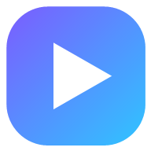
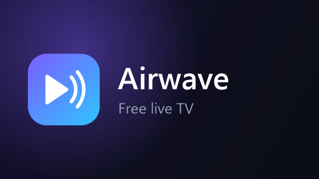
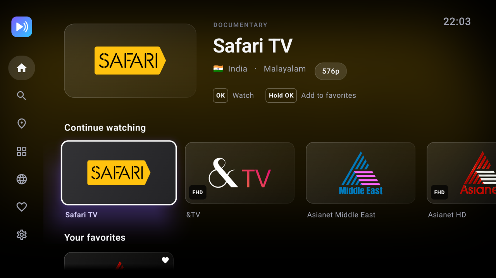
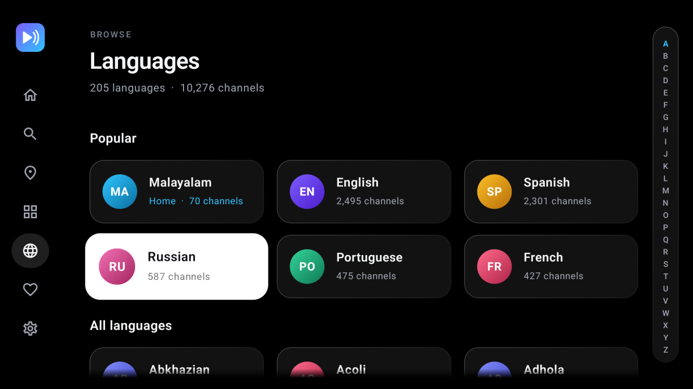
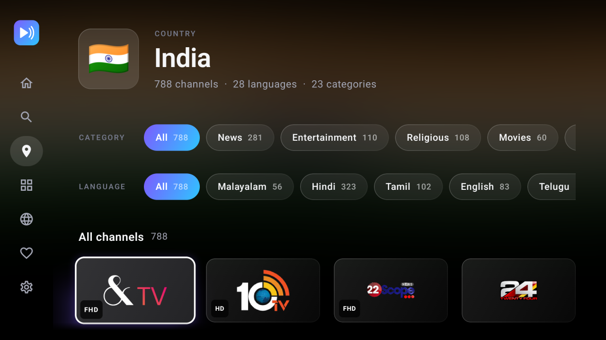
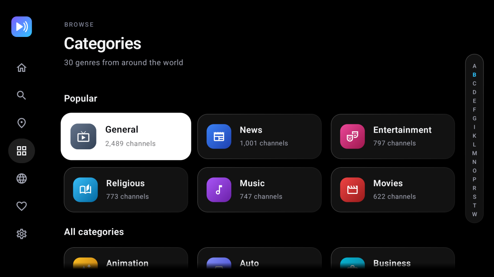
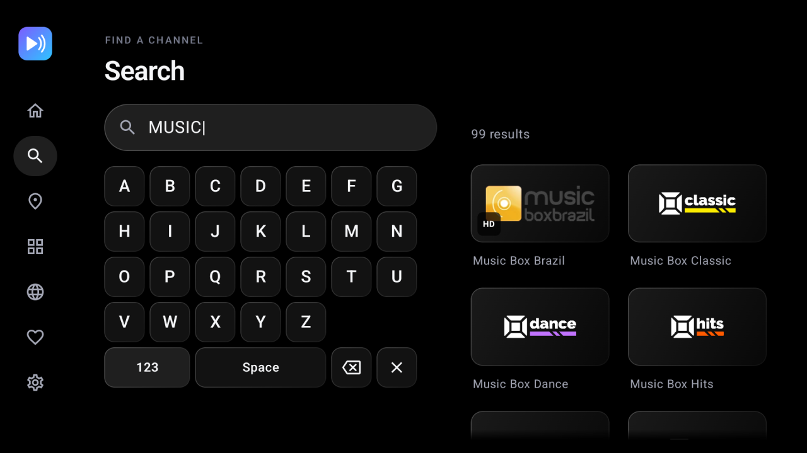
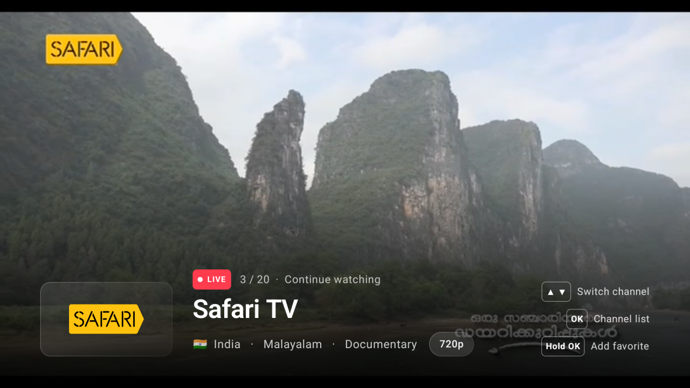
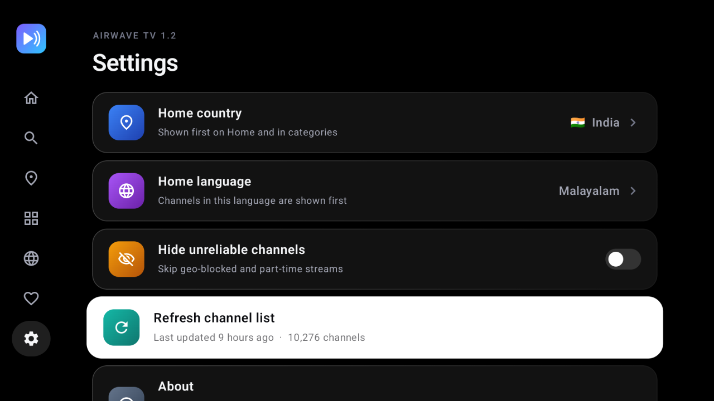

<div align="center">



# Airwave TV

**Free live TV for Google TV and Android TV.**
10,000+ channels from 180 countries in 200+ languages, built for the remote.

[](#installation)
[](app/build.gradle.kts)
[](https://kotlinlang.org)
[](https://developer.android.com/jetpack/compose)
[](../../releases/latest)

[Download](../../releases/latest) · [Features](#features) · [Installation](#installation) · [Build](#building-from-source)

</div>

---

## Table of contents

- [About](#about)
- [App icon and banner](#app-icon-and-banner)
- [Screenshots](#screenshots)
- [Features](#features)
- [Installation](#installation)
- [Remote controls](#remote-controls)
- [Building from source](#building-from-source)
- [Project structure](#project-structure)
- [How it works](#how-it-works)
- [Tech stack](#tech-stack)
- [Contributing](#contributing)
- [Disclaimer](#disclaimer)
- [Acknowledgements](#acknowledgements)
- [License](#license)

## About

Airwave TV is an IPTV player for the big screen. It loads the public, community-maintained
[iptv-org/iptv](https://github.com/iptv-org/iptv) playlist and turns it into a TV-style app: rows of
channels on Home, browsing by country, category and language, search with an on-screen keyboard,
favorites, and a full-screen player you can zap through with the D-pad.

## App icon and banner

| App icon | Google TV home-screen banner |
|:---:|:---:|
|  |  |

## Screenshots

| Home | Languages |
|:---:|:---:|
|  |  |
| **Country page with filters** | **Categories** |
|  |  |
| **Search** | **Player** |
|  |  |
| **Settings** | |
|  | |

## Features

- **Home**: a header showing the highlighted channel over a soft wash of its colours, plus rows for
  *Continue watching*, *Your favorites*, your country, your language, News, Sports, Movies, Music, Kids and more.
- **Browse three ways**: by **country** (with flags), **category** (30 genres) or **language** (200+).
  Each list starts with the most popular entries, then goes A–Z with an **A–Z rail** on the right to jump through it.
- **Combinable filters**: every channel list has chip rows for Category, Country and Language, with channel
  counts, e.g. *Religious → India → Hindi*.
- **Search**: a letters-only on-screen keyboard made for the remote (press **123** for digits), with results as you type.
- **Look and feel**: a black theme with frosted-glass panels, a short logo intro on launch, and a round-friendly
  adaptive icon for the Google TV home screen.
- **Favorites**: hold **OK** on any channel, or while watching, to add or remove it.
- **Home country and home language**: your channels come first on Home and in every list.
- **Player**: HLS, DASH and progressive streams via Media3/ExoPlayer, channel zapping, a slide-in
  channel list, live resolution display, and automatic fallback to a channel's alternative streams.
- **Works with messy streams**: tolerates malformed HLS timestamps that make other players reject a channel.
- **Settings**: hide geo-blocked and part-time channels, refresh the channel list on demand.

## Installation

Download the APK (for example **`AirwaveTV-1.2.apk`**) from the [latest release](../../releases/latest), then sideload it.

### Option A: ADB over Wi-Fi

1. On the TV, open *Settings → System → About* and press **Android TV OS build** 7 times to enable
   Developer options.
2. In *Settings → System → Developer options*, turn on **USB debugging**
   (on newer Google TV models: **Wireless debugging**).
3. Find the TV's IP address under *Settings → Network & Internet → (your network)*.
4. On your computer, run:

   ```bash
   adb connect <TV_IP>:5555
   adb install -r AirwaveTV-1.2.apk
   ```

   Accept the *Allow USB debugging?* prompt on the TV the first time.

> **Wireless debugging (Google TV 12+):** pair first with `adb pair <ip>:<pairing-port>` using the code
> shown on the TV, then `adb connect <ip>:<port>` with the port from the main Wireless debugging screen.

### Option B: Send Files to TV

1. Install **Send Files to TV** (or **Downloader**) from the Play Store on the TV.
2. Allow it to install unknown apps: *Settings → Apps → Security & restrictions → Unknown sources*.
3. Send the APK from your phone or PC to the TV and open it.

Airwave TV then appears in the **Apps** row on Google TV.

### Requirements

- Android TV or Google TV running Android 6.0 or later
- An internet connection (the channel list is about 5 MB and refreshes every 12 hours)

## Remote controls

| Where | Button | Action |
|---|---|---|
| Anywhere | ◀ (from content) / Back | Open the side menu |
| Countries, categories, languages | ▶ from the right edge | Open the A–Z rail; ▲ ▼ jump, OK or ◀ go to that letter |
| Channel tile | OK | Watch |
| Channel tile | Hold OK | Add or remove favorite |
| Player | ▲ / ▼ (or CH+ / CH−) | Previous / next channel |
| Player | OK or ◀ | Channel list |
| Player | ▶ | Show channel info |
| Player | Hold OK | Add or remove favorite |
| Player | Back | Close the list / leave the player |

## Building from source

### Prerequisites

- JDK 17
- Android SDK with platform 34 (the Android Gradle Plugin downloads it if your SDK licenses are accepted)

### Build

```bash
git clone https://github.com/tonalmathew/AirwaveTV.git
cd AirwaveTV
./gradlew assembleRelease
```

The APK is written to `app/build/outputs/apk/release/app-release.apk`. Release builds are signed with
the debug key so they can be sideloaded directly.

### Install on a connected TV

```bash
adb install -r app/build/outputs/apk/release/app-release.apk
```

## Project structure

```
app/src/main/java/com/airwave/tv/
├── App.kt                 # Application: image loader setup
├── MainActivity.kt        # Hosts the Compose UI, D-pad focus recovery
├── data/
│   ├── Models.kt          # Channel, Stream, Country, Catalog
│   ├── M3uParser.kt       # Parses iptv-org playlists, merges feeds into channels
│   ├── Repository.kt      # Download + cache, user preferences
│   └── Library.kt         # Indexes by country / category / language, search, ranking
└── ui/
    ├── AppViewModel.kt    # App state, navigation, filters, favorites
    ├── Shell.kt           # Root layout, side menu, error screen
    ├── SplashScreen.kt    # Logo intro
    ├── HomeScreen.kt      # Header + channel rows
    ├── BrowseScreens.kt   # Countries, categories, languages, channel lists, favorites
    ├── AlphabetIndex.kt   # Popular + A–Z grid with the A–Z rail
    ├── SearchScreen.kt    # On-screen keyboard + results
    ├── SettingsScreen.kt  # Home country / language, toggles, refresh
    ├── PlayerScreen.kt    # Media3 player, overlay, channel list, stream fallback
    ├── Components.kt      # Focusable cards, chips, buttons
    └── Theme.kt, Styles.kt  # Colours, glass surfaces, category icons and gradients
```

## How it works

- **Channel data**: on first launch the app downloads
  [`index.m3u`](https://iptv-org.github.io/iptv/index.m3u) (channels, logos, categories),
  [`index.language.m3u`](https://iptv-org.github.io/iptv/index.language.m3u) (languages, matched by
  stream URL) and [`countries.json`](https://iptv-org.github.io/api/countries.json) (names and flags).
  Everything is cached and refreshed every 12 hours.
- **Channels, not streams**: feeds of the same channel (for example SD and HD) are merged into one
  channel with several streams, ordered by reliability and quality.
- **Playback**: a stream with an unknown format is tried as HLS first (most IPTV streams are HLS, even
  behind `.php` URLs), then as a raw MPEG-TS stream; known formats get one retry. After that the player
  moves to the channel's next alternative stream. A stream that doesn't start within 20 seconds counts
  as failed.

## Tech stack

| Area | Library |
|---|---|
| Language | Kotlin 1.9 |
| UI | Jetpack Compose (Material 3), D-pad focus handling |
| Playback | AndroidX Media3 / ExoPlayer (HLS, DASH, progressive) |
| Images | Coil |
| Async | Kotlin Coroutines |
| Build | Gradle 8.5, Android Gradle Plugin 8.2 |

## Contributing

Issues and pull requests are welcome. For larger changes, please open an issue first to discuss what
you'd like to change. Test on a real TV or a TV emulator with the D-pad, since everything must be usable
without a touchscreen.

## Disclaimer

Airwave TV doesn't host, provide or control any streams. All channels come from the public
[iptv-org](https://github.com/iptv-org/iptv) playlist, which lists streams that broadcasters make
publicly available. Some channels may be offline or geo-blocked at any time. If you're a rights holder
with concerns about a stream, contact the [iptv-org project](https://github.com/iptv-org/iptv).

## Acknowledgements

- [iptv-org/iptv](https://github.com/iptv-org/iptv) for the channel playlists
- [iptv-org/api](https://github.com/iptv-org/api) for country data

## License

This project doesn't have a license yet, so all rights are reserved by the author.
